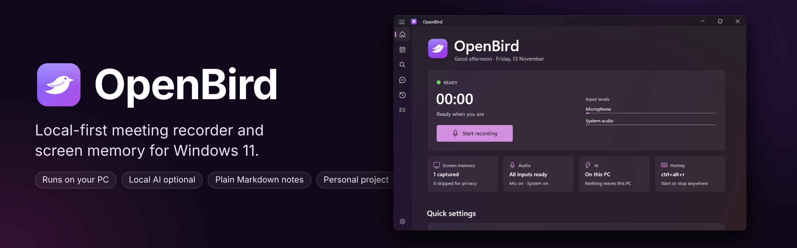
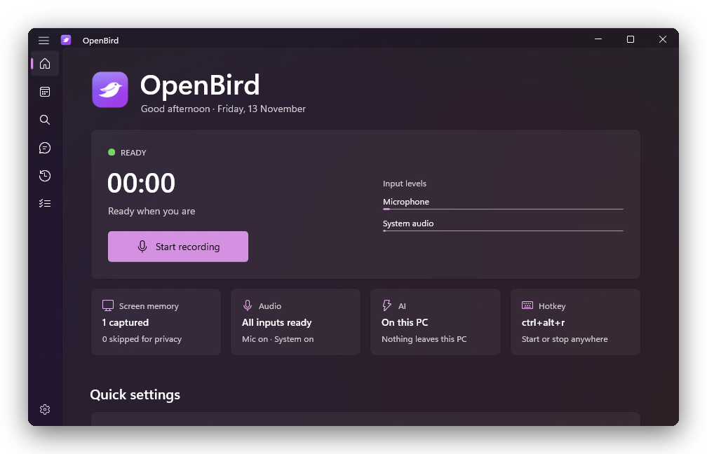
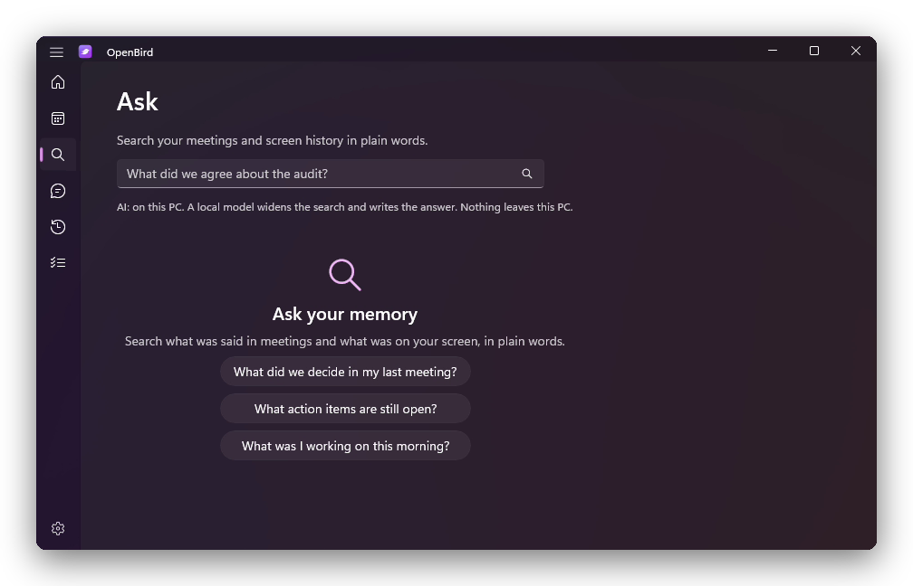
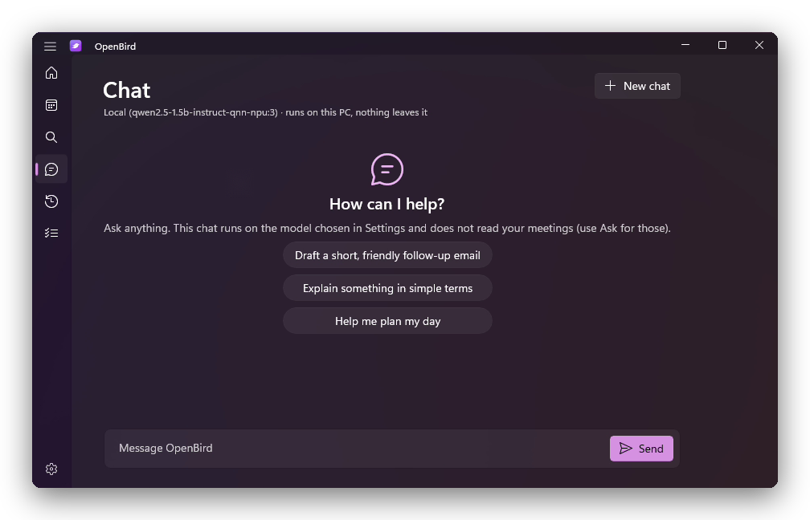
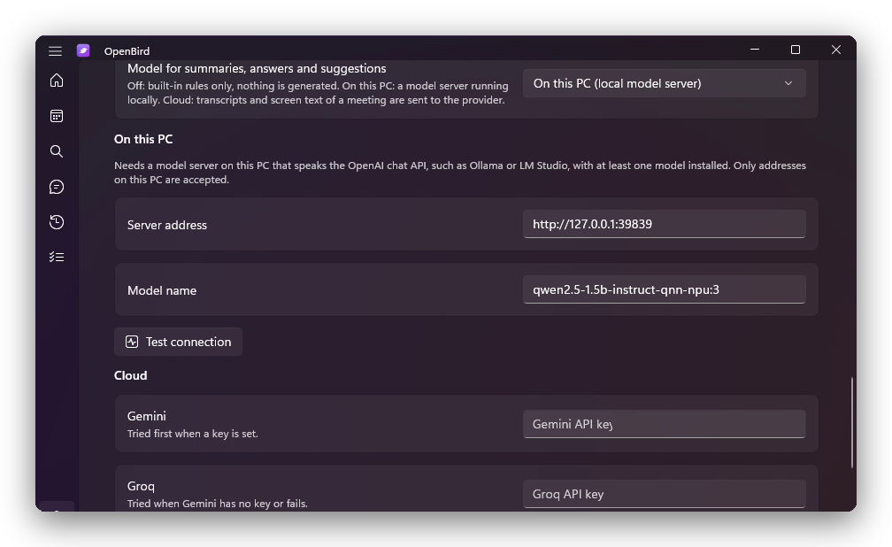
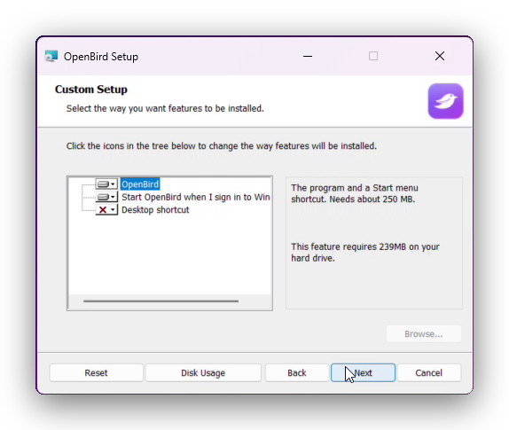

<p align="center">
  
</p>

# OpenBird

**A local-first meeting recorder and screen memory for Windows 11.** It records your microphone and system audio, transcribes offline with Whisper, reads your screen with Windows OCR, and writes plain Markdown notes you can search, ask questions about, and hand to any other tool.

[](https://github.com/TH0MSX/OpenBird/releases/latest)
[](https://th0msx.github.io/OpenBird/)
[](https://github.com/TH0MSX/OpenBird/releases/latest)


[](LICENSE)

[Features](#what-it-does) · [Install](#install) · [Tested on](#how-far-it-has-been-checked) · [Privacy and law](#privacy-and-the-law) · [Limitations](#limitations)

<p align="center">
  
</p>

> [!IMPORTANT]
> **This is a personal project.** I built it for my own use, I maintain it when I have time, and it comes with no support and no warranty.
>
> **Check your data-protection and recording laws before you use it.** OpenBird records audio of other people and reads text from your screen. In the EU and UK that is personal data under the GDPR, and in many places recording a conversation needs the consent of the other people in it. Read [PRIVACY-AND-LEGAL.md](PRIVACY-AND-LEGAL.md) first. It is not legal advice. Do not run OpenBird on a work computer or in a work meeting without your employer's permission.

> [!NOTE]
> **v3.1.0 is a stable release.** The core logic is covered by 99 automated tests, and the app has been used daily. It has been tested on one machine, a Windows 11 ARM64 PC, so read [How far it has been checked](#how-far-it-has-been-checked) before you rely on it.
>
> **The recommended way to use it is to clone the repository, read the code, and change what you need.** The MSI is there for convenience. It is unsigned, so Windows SmartScreen will warn you.

## What it does

| | |
| :--- | :--- |
| **Records both sides** | Microphone and system audio as two channels. Starts when it hears speech, or on a hotkey. |
| **Transcribes offline** | Whisper through sherpa-onnx, on your PC. No audio leaves it. |
| **Remembers your screen** | Takes a capture every 20 seconds, reads it with Windows OCR and keeps a searchable timeline. Windows that look private (password managers, sign-in pages, private browsing, banking) are skipped before capture. |
| **Writes notes as Markdown** | Summary, decisions, action items and a full transcript, one file per meeting, plus a daily digest and a task list. |
| **Ask** | Ask questions over meetings and screen history in plain words, and get an answer with its sources. |
| **Chat** | A general chat tab that uses the model you choose. It does not read your meetings. |
| **Three AI modes** | **Off:** built-in rules only, nothing is generated. **On this PC:** a model server on your own machine, for example Foundry Local, Ollama or LM Studio. **Cloud:** Gemini or Groq, only if you add a key. |
| **Windows-native** | WinUI 3, notifications through Windows app notifications, a tray menu, and an MSI that installs per user without administrator rights. |

<p align="center">
  
  
</p>
<p align="center">
  
  
</p>

## Install

### Option 1 (recommended): clone it and build it

You need Windows 11, the [.NET 10 SDK](https://dotnet.microsoft.com/download) and about 1 GB of free disk space.

```powershell
git clone https://github.com/TH0MSX/OpenBird.git
cd OpenBird\dotnet
.\install.ps1
```

`install.ps1` builds a self-contained copy for your own processor (ARM64 or x64), installs it to `%LOCALAPPDATA%\Programs\OpenBird`, and adds a Start menu shortcut. No administrator rights are needed, and nothing is installed system-wide. Read the script and the code first, and change what you want.

To build the MSI yourself:

```powershell
cd OpenBird\dotnet
.\installer\build-msi.ps1
```

The MSI lands in `dotnet\dist\`. It uses WiX Toolset 5.0.2 as a local dotnet tool, so nothing is installed system-wide.

### Option 2: the MSI from the release page

1. Download `OpenBird-3.1.0-arm64.msi` from the [latest release](https://github.com/TH0MSX/OpenBird/releases/latest).
2. Check it. The SHA-256 is in the release notes. In PowerShell: `Get-FileHash .\OpenBird-3.1.0-arm64.msi`
3. Double-click it. Windows SmartScreen may say the publisher is unknown, because the file is not code-signed. Choose **More info**, then **Run anyway**, only if the hash matches.
4. Pick your options (start with Windows, desktop shortcut), install, and let it open OpenBird.

The release ships an **ARM64** MSI only, because that is the only hardware I have tested on. On an x64 PC, use Option 1.

### First run

A short guided setup checks your microphone and system-audio levels, asks whether to turn screen memory on, and offers to start OpenBird when you sign in. The first time, you download the speech model (about 200 MB, from the sherpa-onnx release page on GitHub). After that, transcription works offline. The label for your own voice in transcripts comes from your Windows account name. You can change it in Settings. `Win + Alt + R` toggles recording. If another program already owns that hotkey, OpenBird falls back to `Ctrl + Alt + R` and tells you.

## Where your data lives

| What | Where |
| :--- | :--- |
| Settings (including any API keys) | `%LOCALAPPDATA%\OpenBird\config.json` |
| Logs | `%LOCALAPPDATA%\OpenBird\logs\openbird.log` |
| Database, recordings, screenshots | `%LOCALAPPDATA%\OpenBird\data` |
| Speech model | `%LOCALAPPDATA%\OpenBird\models` |
| Meeting notes, daily digests, screen journal, tasks | `Documents\OpenBird` (you can change this in `config.json` with `storage_dir`) |

The notes are plain Markdown. That is deliberate: any other tool, including an AI coding assistant, can read them. [docs/using-with-other-tools.md](docs/using-with-other-tools.md) explains the file layout.

Uninstalling removes the program only. Your notes, recordings and settings are never touched, so delete those folders yourself if you want them gone.

## How far it has been checked

| Area | Status |
| :--- | :--- |
| Core logic (notes, search, digest, tasks, AI modes, chat history, local-model handling) | 99 automated tests, all passing. |
| App on Windows 11 ARM64 | Used daily on one PC, from install to recording to Ask. |
| Local AI through Foundry Local on the NPU | Works with a small model (Qwen 2.5 1.5B). A 7B model failed to load on a 16 GB machine. |
| Windows 11 x64 | **Not tested.** The code builds for x64, but I have not run it there. |
| Windows 10 | **Not tested** and not supported. |
| MSI installer | Built and installed on the ARM64 PC. Unsigned. Not tested on other machines. |
| Cloud AI (Gemini, Groq) | Implemented and covered by unit tests with fake providers. Use it only if you accept that your text goes to that provider. |

## Privacy and the law

OpenBird keeps everything on your PC unless you switch cloud AI on. That is a good start, and it is not the same as being compliant.

- It records **other people's voices** and captures **text on your screen**, which can include their names, messages, and anything confidential.
- Under the GDPR (and UK GDPR) that is processing of personal data. You need a lawful basis, you need to tell the people involved, and you need to keep it to what you need. Some countries and US states also require **all parties to consent** before a call is recorded.
- Screenshots, the database and the API keys in the settings file are **stored unencrypted**. Protect the PC (disk encryption, a locked account) and keep the folders out of cloud sync you do not control.
- Cloud mode sends transcripts and screen text to Google or Groq. That is a transfer to a third party, possibly outside your country.

[PRIVACY-AND-LEGAL.md](PRIVACY-AND-LEGAL.md) lists what is stored, what is sent where, and a short checklist to go through before you use it. I am not a lawyer and this project gives no legal advice.

## Limitations

- Keys, screenshots and the database are not encrypted at rest.
- Only one hardware setup has been tested (ARM64). The release has no x64 build.
- The window-title filter cannot see inside every browser. Chrome does not label Incognito windows in the title, so add your own patterns for anything sensitive.
- Remote speakers are one channel. OpenBird labels them "Remote Participants" and does not separate individual people.
- Summaries from small local models can be wrong. Check anything important against the transcript.
- No code signing, so SmartScreen warns on the MSI. No auto-update.
- It is a personal project, so expect rough edges and slow replies.

## Repository layout

| Path | What it is |
| :--- | :--- |
| `dotnet/src/OpenBird.Core` | Notes, search, Ask, Chat, digest, AI providers. No Windows dependency. |
| `dotnet/src/OpenBird.Speech` | Offline transcription (sherpa-onnx Whisper). |
| `dotnet/src/OpenBird.Windows` | Audio capture, screen capture, OCR, tray icon, engine. |
| `dotnet/src/OpenBird.App` | The WinUI 3 app. |
| `dotnet/tests` | Automated tests for the core. |
| `dotnet/installer` | WiX MSI authoring and `build-msi.ps1`. |
| `openbird/`, `main.py` | The retired first version, written in Python. Kept for reference. It is not the app you get from the MSI. |
| `docs/` | Homepage (GitHub Pages), banner and screenshots. |
| `scripts/` | Release helpers. |

## Licence

[PolyForm Noncommercial 1.0.0](LICENSE). You can use, study, change and share OpenBird for any **noncommercial** purpose, including personal use, research and hobby projects. You cannot use it commercially. See [NOTICE](NOTICE) for the required notice.

Third-party components keep their own licences, including sherpa-onnx and Whisper models, the Windows App SDK, and WiX Toolset (build time only).
